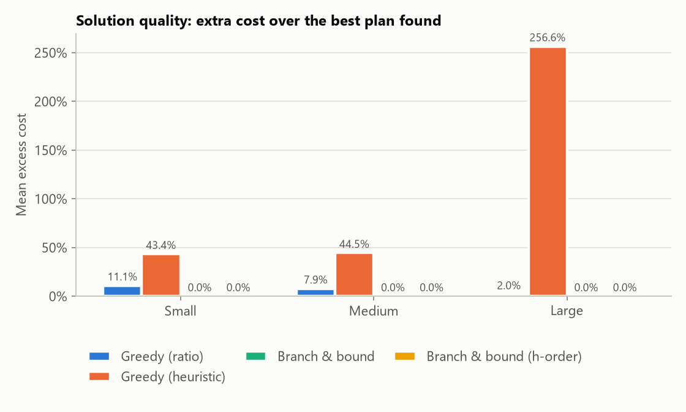
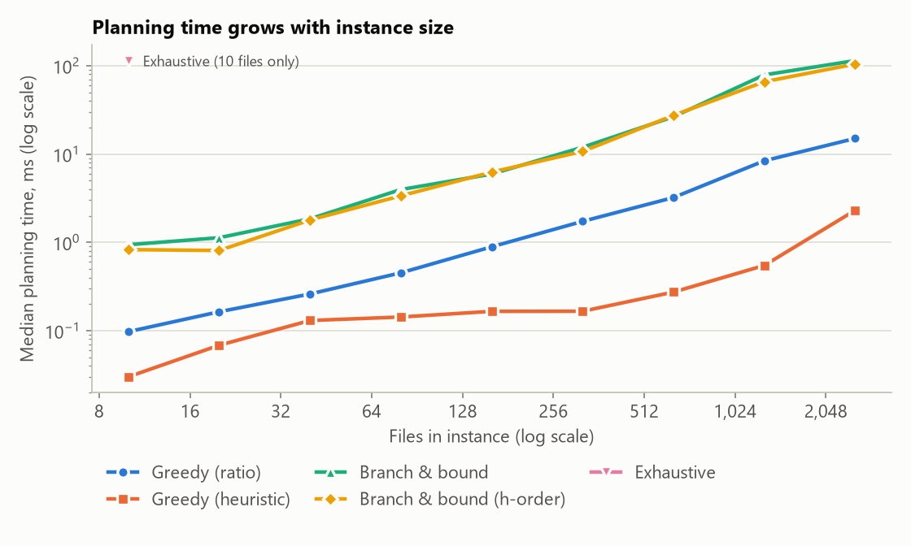
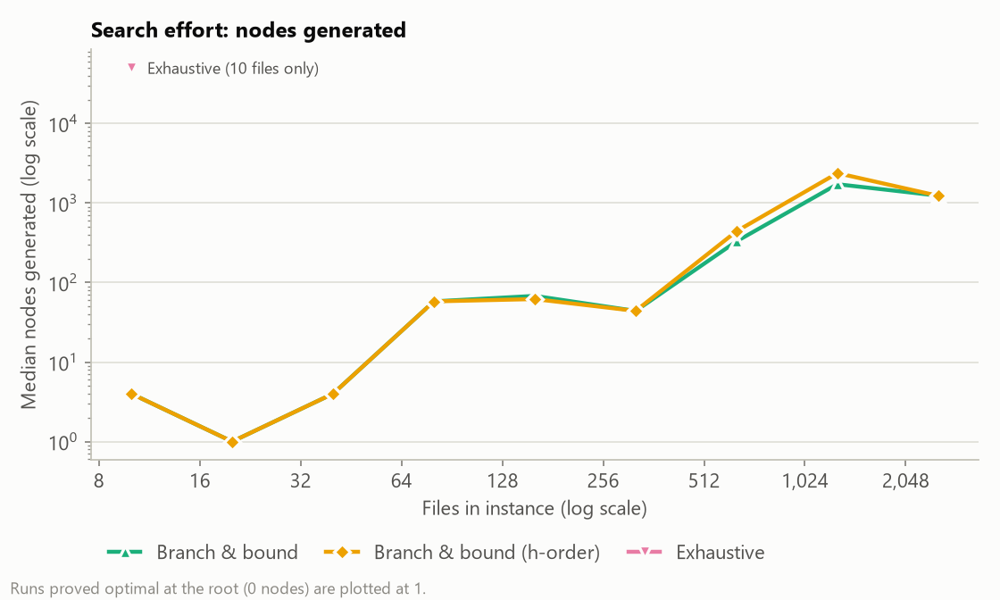
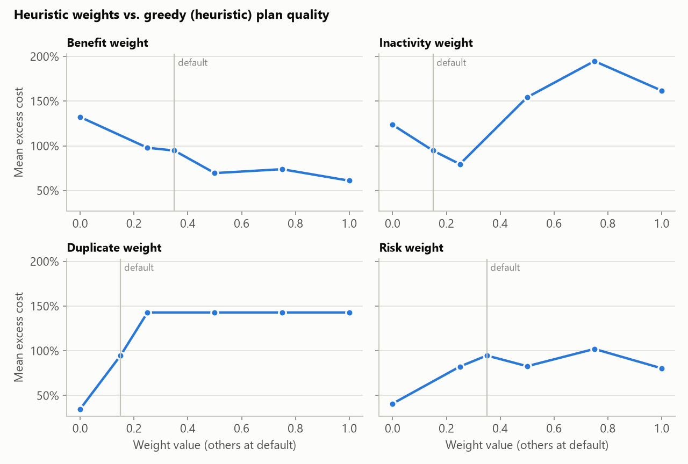
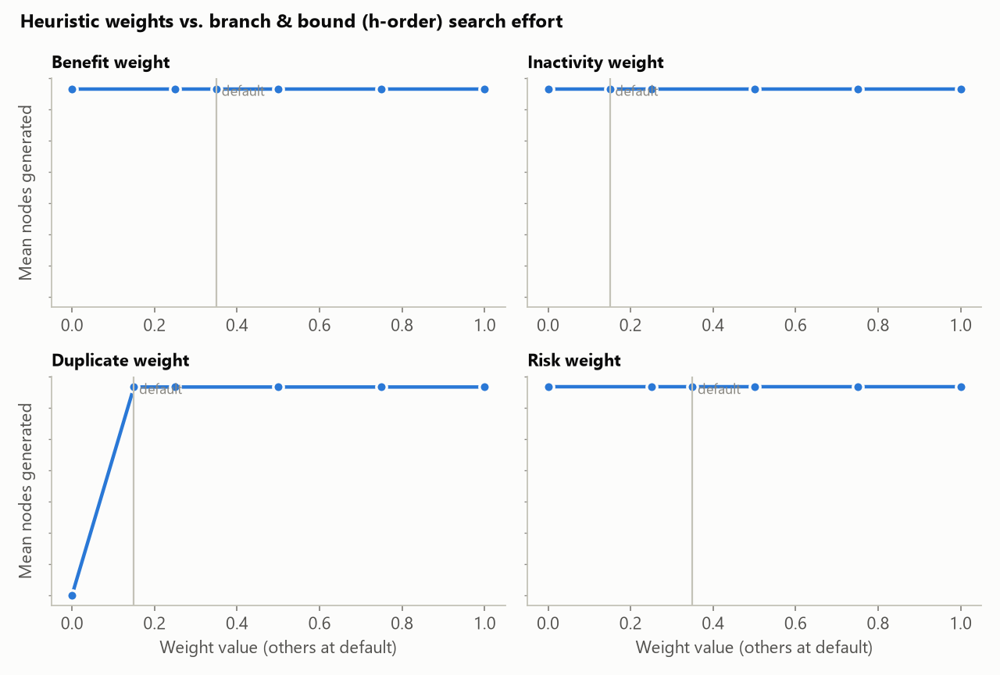

# StorageOps: Benchmark Results

Results of the Phase 4 benchmark (`storageops bench`), comparing the cleanup planners on
synthetic storage environments. No real user files are involved: every instance is a
generated file table with realistic sizes, ages, folders and duplicates.

| | |
|---|---|
| Run | 13 Oct 2026, Windows 11, Python 3.12.7, single thread |
| Command | `python scripts/run_benchmarks.py` (full settings) |
| Duration | 31 s for the whole experiment |
| Branch-and-bound time limit | 5 s per instance |
| Seeds | 3 random instances per configuration |
| Raw data | `results/results.csv`, `results/scaling.csv`, `results/sensitivity.csv` (regenerate with the command above) |

The interpretation of these numbers, including the failure modes and threats to validity,
is in [failure_analysis.md](failure_analysis.md).

## 1. Planners compared

| Label | Planner | Role |
|---|---|---|
| Greedy (ratio) | `GreedyPlanner("ratio")`: cheapest bytes first along each file's action hull | Baseline |
| Greedy (heuristic) | `GreedyPlanner("heuristic")`: highest heuristic score h(f, a) first | Heuristic study |
| Branch & bound | `BranchAndBoundPlanner()`: LP-bounded DFS, bound-ordered actions | Advanced (default) |
| Branch & bound (h-order) | Same search, actions ordered by h | Heuristic study |
| Exhaustive | Full enumeration of the state space (≤ 12 files) | Ground truth |

## 2. Instances

**Main grid.** 3 size classes × duplicate ratio {0, 0.3} × risk level {low, mixed, high} ×
target {10%, 30% of unprotected bytes} × 3 seeds = **108 instances** (468 planner runs).

| Size class | Files | Exhaustive search? |
|---|---|---|
| small | 10 | yes |
| medium | 150 | no |
| large | 1,500 | no |

| Risk level | Typical content | Median file age |
|---|---|---|
| low | temp, cache, logs, installers | ~400 days |
| mixed | everything | ~150 days |
| high | documents, source code, data | ~30 days |

**Scaling study.** 10 → 2,560 files (doubling), mixed risk, 20% duplicates, 20% target,
3 seeds per size.

**Weight sensitivity.** 6 medium instances (150 files, 30% duplicates, mixed risk, 20% target);
each heuristic weight swept over {0, 0.25, 0.5, 0.75, 1} plus its default, the other weights
at their defaults.

**Quality metric.** *Excess cost* = plan cost ÷ cheapest goal plan any planner found on the
same instance − 1. Branch-and-bound proved optimality on every feasible instance, so this
is excess over the **true optimum**.

## 3. Overall results

| Planner | Runs | Plans found | Equal to optimum | Proven optimal | Time-limit hits |
|---|---|---|---|---|---|
| Greedy (ratio) | 108 | 83 | 57% | n/a | 0 |
| Greedy (heuristic) | 108 | 83 | 35% | n/a | 0 |
| **Branch & bound** | 108 | 83 | **100%** | **100%** | **0** |
| Branch & bound (h-order) | 108 | 83 | 99% | 99% | 1 |
| Exhaustive (small only) | 36 | 30 | 100% | 100% of feasible | 0 |

"Plans found" is 83 of 108 for every planner because **25 instances are provably
infeasible** (section 6); no planner can or should find a plan there.

## 4. Solution quality by size class



Mean (and worst) excess cost over the optimum, on instances where a plan exists:

| Planner | Small (10 files) | Medium (150) | Large (1,500) |
|---|---|---|---|
| Greedy (ratio) | 11.1% (max 220%) | 7.9% (max 47%) | 2.0% (max 14%) |
| Greedy (heuristic) | 43.4% (max 1,065%) | 44.5% (max 142%) | 256.6% (max 1,157%) |
| **Branch & bound** | **0%** | **0%** | **0%** |
| Branch & bound (h-order) | 0% | 0% | 0.0% (one run 0.31%) |
| Exhaustive | 0% | n/a | n/a |

Mean number of actions in the plan:

| Planner | Small | Medium | Large |
|---|---|---|---|
| Greedy (ratio) | 1.2 | 4.8 | 31.7 |
| Greedy (heuristic) | 1.4 | 13.5 | 183.3 |
| Branch & bound | 1.3 | 6.4 | 32.7 |

## 5. Speed and search effort

Median / maximum planning time on the main grid:

| Planner | Small | Medium | Large |
|---|---|---|---|
| Greedy (ratio) | 0.10 ms | 0.84 ms / 2 ms | 8.8 ms / 26 ms |
| Greedy (heuristic) | 0.04 ms | 0.12 ms / 1 ms | 1.0 ms / 6 ms |
| Branch & bound | 0.99 ms / 2 ms | 4.5 ms / 73 ms | 56 ms / **3.8 s** |
| Branch & bound (h-order) | 0.85 ms / 2 ms | 4.4 ms / 38 ms | 47 ms / 5.0 s (limit) |
| Exhaustive | 20 ms / 722 ms | n/a | n/a |

### Scaling with instance size



| Files | Greedy (ratio) | Greedy (heuristic) | Branch & bound | B&B (h-order) | Exhaustive |
|---|---|---|---|---|---|
| 10 | 0.10 ms | 0.03 ms | 0.94 ms | 0.83 ms | 114 ms |
| 20 | 0.16 ms | 0.07 ms | 1.13 ms | 0.81 ms | n/a |
| 40 | 0.26 ms | 0.13 ms | 1.85 ms | 1.79 ms | n/a |
| 80 | 0.45 ms | 0.14 ms | 3.96 ms | 3.37 ms | n/a |
| 160 | 0.89 ms | 0.17 ms | 5.93 ms | 6.24 ms | n/a |
| 320 | 1.73 ms | 0.17 ms | 12.0 ms | 10.7 ms | n/a |
| 640 | 3.22 ms | 0.27 ms | 26.4 ms | 27.4 ms | n/a |
| 1,280 | 8.38 ms | 0.55 ms | 78.7 ms | 65.8 ms | n/a |
| 2,560 | 15.0 ms | 2.30 ms | 114 ms | 105 ms | n/a |

Median times. Branch-and-bound never hit its time limit in the scaling study and proved
every instance optimal.



| Files | Branch & bound | B&B (h-order) | Exhaustive |
|---|---|---|---|
| 10 | 4 | 4 | **50,184** |
| 80 | 58 | 58 | n/a |
| 640 | 330 | 442 | n/a |
| 1,280 | 1,728 | 2,382 | n/a |
| 2,560 | 1,240 | 1,234 | n/a |

Median nodes generated. At 10 files the LP bound plus the greedy starting plan cut the search
from 50,184 nodes to 4, a ~12,500× reduction.

## 6. Feasibility: when the target cannot be reached safely

| Risk level | Feasible | Proven infeasible |
|---|---|---|
| low | 100% | 0% |
| mixed | 92% | 8% |
| high | 39% | 61% |

25 of 108 instances are infeasible. In 23 of them, even the most generous *allowed* action per
file cannot reach the target. In high-risk environments, deleting recent documents breaks
the safety threshold, and archiving or compressing frees only part of each file. The other
2 are blocked by the "always keep one copy of a duplicate" rule. Branch-and-bound detects
infeasibility in milliseconds, usually at the root of the search.

## 7. Heuristic weight sensitivity



Mean excess cost of **Greedy (heuristic)** as one weight varies (others at default; the
default value of each weight is in bold):

| Value | Benefit | Inactivity | Duplicate | Risk |
|---|---|---|---|---|
| 0 | 132% | 124% | **35%** (best) | **41%** (best) |
| 0.15 | n/a | **95%** (default) | **95%** (default) | n/a |
| 0.25 | 98% | 80% | 143% | 82% |
| 0.35 | **95%** (default) | n/a | n/a | **95%** (default) |
| 0.5 | 70% | 154% | 143% | 83% |
| 0.75 | 74% | 195% | 143% | 102% |
| 1.0 | **61%** (best) | 162% | 143% | 80% |



**Branch & bound (h-order)** generated the same ~127 nodes on average (range 10–578 across
instances) for **every** weight setting, and proved all runs optimal. With a good starting
plan and a tight bound, action ordering hardly matters.

## 8. Key takeaways

1. **Branch-and-bound is optimal and fast:** 100% optimal plans, a median of 56 ms and a
   maximum of 3.8 s on 1,500-file instances, with roughly linear growth up to 2,560 files.
2. **Ratio greedy is a good fast fallback on large instances** (2% from optimal), but it can
   be up to 220% worse on small ones. It overshoots by picking one big file when only part
   of it is needed.
3. **The heuristic is a poor objective.** Ranking by h is 35–257% worse than optimal on
   average, and no weight setting fixes that. Raising the benefit weight helps most; the
   duplicate and risk weights help most at 0. h is therefore used only to explain choices
   and to order the search.
4. **Safety rules decide feasibility:** most infeasible targets occur in high-risk
   environments, and StorageOps reports them instead of deleting important files.

## 9. Reproducing

```bash
cd storageops
.venv\Scripts\activate
python scripts/run_benchmarks.py -o results    # asks for OK, ~30 s
storageops bench --quick                       # smoke test, a few seconds
```

Instance generation is deterministic (seeded from each instance's name), so quality
numbers reproduce exactly; timings vary with the machine.
